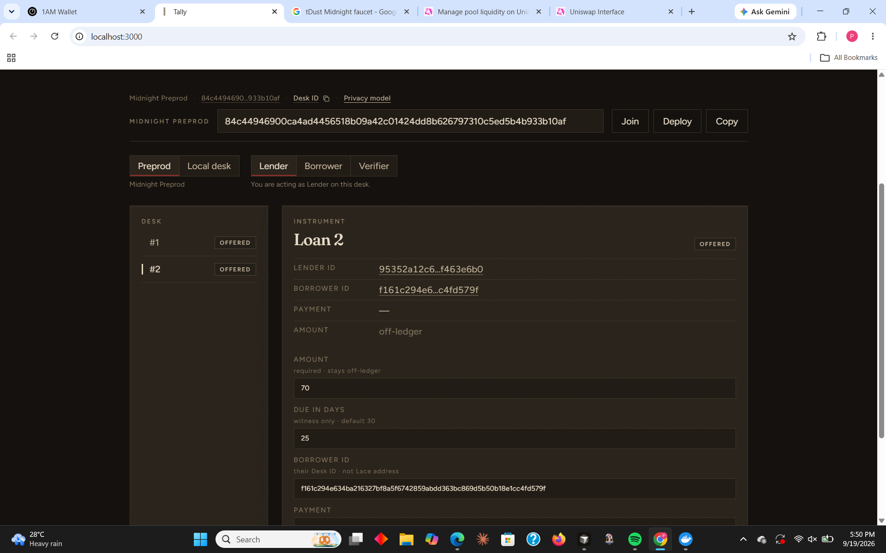
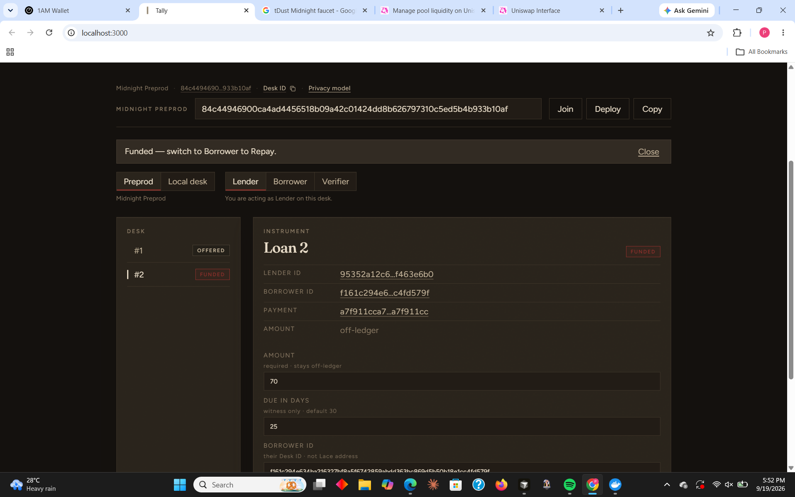
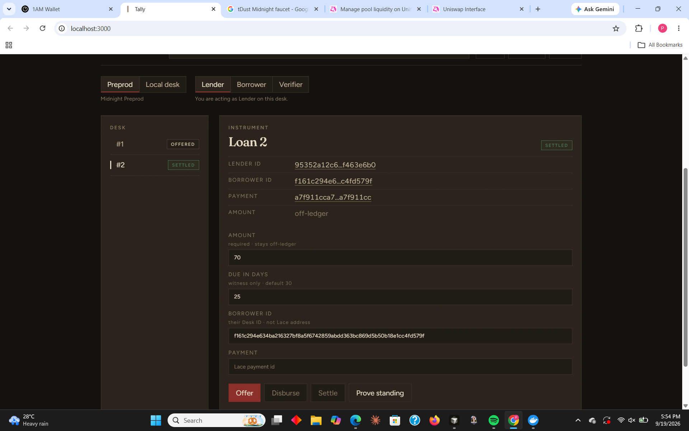
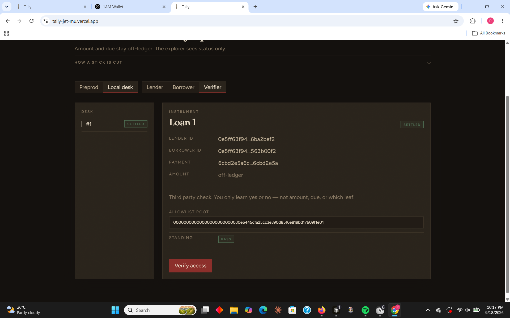
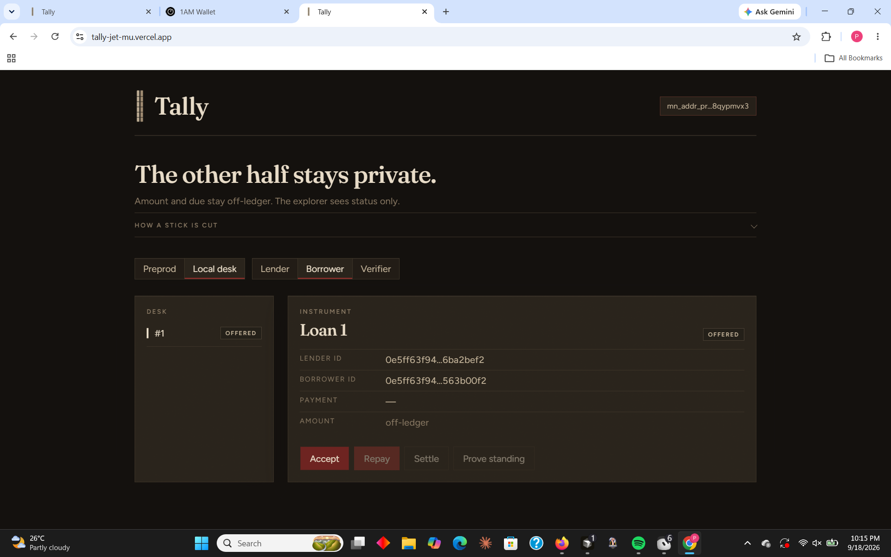
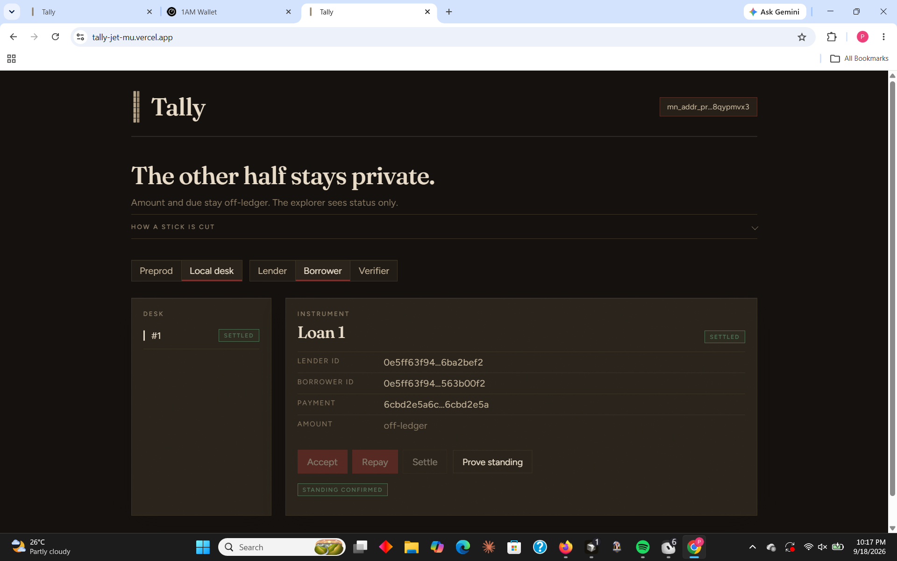

# Tally

Private bilateral trade credit on Midnight. Loan amounts and due dates stay off the public ledger. When a loan settles, you can prove repaid standing to someone new — yes or no only.

This project is built on the Midnight Network.

[Live desk](https://www.tallylend.site) · [Docs](https://tally-a9233c8f.mintlify.site/) · [Demo](https://drive.google.com/file/d/1kvrBCWi8tmJ0JUSjKFEFucGfp7BwmIAZ/view?usp=sharing) · [X](https://x.com/tally_lend)

[](https://github.com/Preciousbas/tally/actions/workflows/ci.yml)

## Try Tally in 5 minutes

1. Open [the desk](https://www.tallylend.site). A first visit opens on Local desk, with no wallet.
2. To use Preprod, install [Lace](https://chromewebstore.google.com/detail/lace/gafhhkghbfjjkeiennaehnffkwbomagd) or [1AM](https://www.1am.xyz/). Set the wallet to Preprod. Request free tNIGHT from the [Midnight Preprod faucet](https://faucet.preprod.midnight.network/), then generate tDUST in the wallet.
3. Click **Connect wallet** and switch to **Preprod**. Name the other person with their private ID.

The local demo does not count on chain.

## Demo

Desk walkthrough with audio: Offer → Accept → Send funds → Repay → Settle → Prove good record → Check a record. Amount stays **Hidden**.

**Video:** [Tally demo on Google Drive](https://drive.google.com/file/d/1kvrBCWi8tmJ0JUSjKFEFucGfp7BwmIAZ/view?usp=sharing)

Docs page: [`docs/demo.mdx`](docs/demo.mdx).

## Documentation

Product docs (Mintlify MDX) live in [`docs/`](docs/index.mdx). Use vs Build index: [`docs/llms.txt`](docs/llms.txt).

```bash
npx mint dev --port 3333
```

`mint` is the Mintlify CLI. Port 3333 avoids the desk on 3000. If the Mintlify client is unavailable:

```bash
npm run docs:preview
```

That serves a Tally-themed HTML preview at http://127.0.0.1:3333. Host docs with [Mintlify](https://mintlify.com) from this repo (`docs.json`). The Vercel project still serves the desk only.

## What this is

Two people make a private loan on Midnight. The amount and due date stay off the public book. When the loan settles, either person can prove they have repaid standing. A checker only learns yes or no. They do not learn how much was lent or who the other party was.

## Live deployment

| | |
|---|---|
| Desk | https://www.tallylend.site |
| Network | Midnight Preprod |
| Contract | `635a4817b625b7954f52b71180da0dbf6c1a50bb538824a3c51fc514e11e77b8` |

Use **Lace** or **1AM** on Preprod. The shared loan book loads on its own. Open **Advanced** only to paste a different address. **Local desk** is a full in-browser demo with no wallet.

## Testers and feedback

Public proof of use and notes from testers:

- [docs/USERS.md](docs/USERS.md)
- [docs/FEEDBACK.md](docs/FEEDBACK.md)

To record testers, add this in the Vercel project:

- `REDIS_URL` — the `redis://` URL from Railway (`redis-cli -u` uses the same string). Do not commit it.

Upstash REST still works if `REDIS_URL` is empty: `UPSTASH_REDIS_REST_URL` and `UPSTASH_REDIS_REST_TOKEN`.

Then export with `node --experimental-strip-types scripts/export-users.ts` and `node --experimental-strip-types scripts/export-feedback.ts`.

## Product tour



Offer on Preprod. Amount stays Hidden. The borrower is named by private ID, not a wallet address.



Lifecycle seals move Offered → Accepted → Funded → Repaid → Settled without disclosing amount.



After settle, Prove good record. Open technical details to copy the allowlist root for a third party.



Check a record learns membership only — Pass or Fail, never the book.

### Local desk

Same flow without a wallet. A first visit opens here.





## How it works

1. **Offer** — Lender sets amount and due (private). On Preprod the borrower is named by private ID.
2. **Accept** — Borrower accepts the loan.
3. **Send funds** — Lender binds a payment commitment. The contract circuit is `disburse`. The amount itself is never disclosed on-chain.
4. **Repay → Settle** — Settlement inserts a relationship leaf and consumes a nullifier.
5. **Prove good record** — A party proves allowlist membership. The contract circuit is `proveStanding`. Someone checking a record learns membership only.
6. **Prove loans repaid** — The borrower proves at least 1, 2, or 3 repaid loans. The contract circuit is `proveRepaidCount`. A checker learns that number and yes or no, not which loans. The public contract above includes this circuit. Its allowlist started empty. Settled loans on the previous contract stay there. A count proof passes only after loans are settled on this address.

## Privacy

**Visible on the public ledger**

- Loan id and status
- Pseudonymous lender and borrower identity grains
- Payment commitment at disbursement
- Relationships allowlist Merkle root
- Settle nullifiers

**Not visible on the public ledger**

- Loan amount
- Due date
- The browser secret that produces a private ID (the contract calls it a Desk ID)
- Which allowlist leaf backs a good-record proof
- Economic terms of prior loans

**What someone checking a record learns**

- A boolean: the prover is in the settled-relationship allowlist at a stated root
- Nothing about amount, due, leaf index, or counterparty

**What a repaid-count checker learns**

- The number N, and yes or no
- Not which loans, amounts, due dates, or lenders from this proof
- Someone who already knows the private ID can still count that person’s settled rows on the public book. The proof does not hide those rows.

## Architecture

```
leaderboard-ui   React desk (Lace / 1AM, Local + Preprod, Lender / Borrower / Check a record)
api              Contract glue and witnesses
contract         tally.compact — offerLoan, acceptLoan, disburse, repay, settle, proveStanding, proveRepaidCount
proof-server     Local proving for Preprod flows
```

Identity comes from a browser secret mixed with a fixed public number, `1234`. That number is a domain tag in the private-ID hash. The contract calls that hash a Desk ID. It is not a password and not a wallet PIN. Public state is `LoanPublic`. Amount and due remain witnesses.

## Setup

```bash
git clone https://github.com/Preciousbas/tally
cd tally
nvm use 22
npm install
```

Install Compact 0.31.1:

```bash
curl --proto '=https' --tlsv1.2 -LsSf https://github.com/midnightntwrk/compact/releases/latest/download/compact-installer.sh | sh
compact update 0.31.1
```

Compile, test, and run the desk:

```bash
cd contract && compact compile +0.31.1 tally.compact managed/tally && npm test
cd .. && npm run dev --workspace leaderboard-ui -- --mode preprod
```

Open http://localhost:3000. For Preprod wallet flows, use Lace or 1AM on Preprod and a proof server on port 6300. Faucet: https://midnight-tmnight-preprod.nethermind.dev/

## Commands

```bash
npm install          # Install workspaces
npm test             # Contract simulation tests (Vitest)
npm run dev          # Desk UI (leaderboard-ui)
```

CI runs `npm install` and `npm test` on push and pull requests to `main`.

## License

Apache-2.0 for Midnight-related code in this repository.
