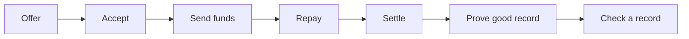

Every Tally loan is between two people. The desk and the Compact contract share the same steps. **Compact** is Midnight’s language for private smart contracts. A **circuit** is one named action in that contract.

Amount and due are checked inside the proof. They stay in witnesses. Status is what an explorer can see. On the desk those two fields read **Hidden**.

On the desk, the flap labeled **How a loan works** lists the same steps. It is a help panel, not a separate page. The contract still names the send-funds circuit `disburse` and the good-record circuit `proveStanding`.

## Status seals

Each loan carries a seal. The seal is the public status.

| Seal | After this action | What the public row holds |
| --- | --- | --- |
| Vacant | Empty slot | — |
| Offered | Offer | Lender and borrower private IDs |
| Accepted | Accept | Same identities |
| Funded | Send funds | Plus a payment commitment |
| Repaid | Repay | Status only |
| Settled | Settle | Leaf added to the allowlist |

Loan rows on the desk show **Amount: Hidden**. The hex ids, the payment commitment, and the allowlist root stay behind **Show technical details**.

## Offer

Who clicks: **Lender**.

The lender sets amount and due as private witnesses. The circuit checks that both are greater than zero and that you are not lending to yourself. A new loan id is created. The public row shows Offered.

On Local desk the borrower is built in, and an empty desk shows only **Offer**. On Preprod you paste the borrower’s **private ID**. The desk calls that value **Your private ID**. The contract calls the same value a Desk ID.

## Accept

Who clicks: **Borrower**.

Only the private ID named in the offer can accept. The seal becomes Accepted. Accept, Repay, Settle, and Prove stay hidden until a loan exists.

## Send funds

Who clicks: **Lender**.

Send funds means “record that payout happened.” The contract circuit is `disburse`. You pass a **payment commitment**. That is a 32-byte sealed mark. It is not the amount. The seal becomes Funded.

## Repay

Who clicks: **Borrower**.

The seal becomes Repaid. No amount is written to the chain.

## Settle

Who clicks: **Lender or Borrower**.

Settle closes the loan after Repaid. The contract:

1. Builds a **nullifier** (a one-time ticket) so the same settle cannot run twice
2. Inserts a **relationship leaf** into the allowlist tree
3. Sets the seal to Settled

## Prove good record

Who clicks: a party to a Settled loan, then someone using **Check a record**.

**Prove good record** builds a membership proof. That means “show I belong on the allowlist without showing which leaf.” The desk copies an allowlist **root** (a fingerprint of the guest list) when technical details are open. **Check a record** uses that root and clicks **Check record**. The seal is Pass or Fail.

**Prove loans repaid** is a second proof. The borrower shows they repaid at least 1, 2, or 3 loans. The checker learns that number and Pass or Fail, not which loans.

## Next

<CardGroup cols={2}>
  <Card title="Privacy" href="/docs/privacy">
    What stays secret at each step.
  </Card>
  <Card title="Desk tour" href="/docs/desk-tour">
    Screenshots and the three roles.
  </Card>
</CardGroup>
